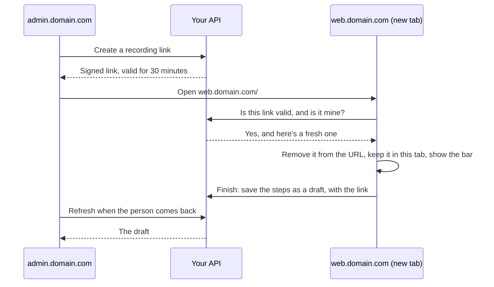

# Recording

Recording turns clicks into steps, so someone who doesn't code can make a walkthrough. It needs `router.routePattern`, which turns `/projects/123` into `/projects/:projectId`.

Add a button and call one thing:

```ts
<button onclick="flinders.record()">Record a walkthrough</button>
```

The bar comes up ready, so the person can go where the walkthrough begins. **Start recording** captures their clicks, with the step count, any warning, Undo and Finish. On Finish the steps are saved as a draft through your admin routes, and the person is told.

To open your own step editor instead, say so in `createFlinders`:

```ts
createFlinders({
  // …
  recording: { onFinish: (steps) => openYourEditor(steps) },
});
```

`flinders.record()` answers where it went: `'here'`, `'tab'`, `'blocked'` (the browser stopped the tab; the person is told to allow pop-ups), `'refused'` (your API said no; they're told) or `'off'`.

## Forks

Forks are recorded on the same bar. Make the choice, press **This has paths**, and click through the path. **Next path** pauses so going back captures nothing; **Record path** starts the next one; **End paths** goes back to shared steps. The first element clicked on a path becomes its `only_if`.

## Your own bar

Pass `recording: { bar: false }` and draw from `onRecordingChange`, or use `recording.bar` to keep ours with your `labels`, `classes` and `unstyled`. Your own bar:

- draws from `flinders.recorder.view`: `ready`, `recorder` (the steps, warning, forks and paused), `stranded` and `fromLink`;
- calls the session's `start()`, `undo()`, `startPaths()`, `nextPath()`, `recordPath()`, `endPaths()`, `stop()`, `cancel()`, and `saveDraft()` when `fromLink`, and `downloadSteps()` when `stranded`;
- is marked `data-flinders-recorder`, so clicks on it aren't steps.

`openFork(view.recorder)` says which path is being recorded.

## When admin and the app are on different sites

Say your admin is `admin.domain.com` and your app is `web.domain.com`. Recording has to happen in the app, because that's where the real screens are. The two sites can't share a page or its memory, so a recording link carries the recording into a new tab, and your API carries the result back.

### What the person does

1. In `admin.domain.com`, press **+ Record walkthrough**. A new tab opens on `web.domain.com`. They never type or change a URL.
2. If they're already signed in there as themselves, the bar is ready straight away, saying who they're recording as. If not, they sign in and the bar appears afterwards.
3. Go to the page where it begins, then press **Start recording**.
4. Click through as normal, then press **Finish**.
5. The tab closes and you land back in `admin.domain.com`, where the draft is waiting. If the browser keeps the tab open, switch back yourself. To keep it open always, set `recording: { jumpBack: false }` in `createFlinders`.

If the link stops working part-way (they left it overnight, or they're no longer allowed to record), the steps stay in the tab and the bar offers them as a file to upload.

### How it works



### What to set up

**The server.** Three values in `createFlinders`. The secret is yours and stays on the server:

```ts
createFlinders({
  query,
  recording: {
    secret: process.env.RECORDING_SECRET, // At least 32 random characters.
    webUrl: 'https://web.domain.com',
    mayRecord: (person) => person.admin, // Your own check, made on every use.
  },
});
```

**Both sites.** Allow `web.domain.com` to save the draft and `admin.domain.com` to read it, with CORS if your API is on a third site. If it signs in with cookies, add `http: { credentials: 'include' }`. The signed-in person must have the same id on both sites.

**The app (`web.domain.com`).** Nothing past `createFlinders` with `routePattern`. Flinders takes the link out of the URL, checks it once someone is signed in, and puts the bar up. Say who's recording with `identity.name`, and call `createFlinders` before your router starts.

If your framework can only create it later, as with Angular's services, and your sign-in page redirects, the link must leave the URL first. Add this one line at the top of your entry file; it's small, and nothing else comes with it:

```ts
import { RecordingTab } from 'flinders/recording-tab';

new RecordingTab();
```

**The admin (`admin.domain.com`).** `flinders.record()`, and what to do with the draft:

```ts
const flinders = createFlinders({
  http: { baseUrl: 'https://api.domain.com/flinders', credentials: 'include' },
  router, // routePattern too, so a same-site recording works here.
  recording: { onDraft: (draft) => openYourEditor(draft.walkthrough_id) },
  toast,
});
```

### Rules

- **Your own account.** A link works only for the person who created it, while `mayRecord` says they can, and every click really happens as them on `web.domain.com`.
- **The link only allows recording.** It never signs anyone in, and it expires 30 minutes after it was last checked.
- **Keep it out of the URL.** It travels after the `#`, which browsers don't send, so it stays out of server logs. It's removed as soon as the page has read it, so it doesn't stay in history or get shared.
- **Keep it in that tab.** Then moving around and reloading don't lose the recording. A normal tab never shows the bar.
- **Nothing typed is recorded.** Only element ids, pages and what finished each step.
- **The link can only add a new draft.** Never a version of an existing walkthrough, and never live. Within a tab it saves one draft; the server keeps no record of used links, so a copy opened in a second tab could save another.
- **Preview across sites isn't built yet.**

`fillRecordedWords` gives blank steps placeholder words, because a saved step can't be blank; `clearRecordedWords` turns them blank again in your step editor, so `draftProblems` asks for them. `copyVersion` refuses to make a version with those words live.

## The parts under it

For a product with its own routes, these are all exported: `RecordingSession` (what `flinders.recorder` is), `Recorder` (the clicks alone), `RecordingTab`, `startRecording`, `watchForRecording`, and on the server `createRecordingLink`, `checkRecordingLinkFor`, `renewRecordingLink`, `recordingLinkUrl`.
